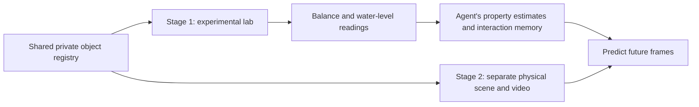

# Experimental property identification

## Two-stage blueprint

The benchmark separates learning object properties from predicting their motion.



**Stage 1 is implemented.** It is a headless tool environment with an equal-arm
beam balance, known reference weights, and a graduated water cylinder. The agent
chooses experiments and estimates each unknown specimen's mass, volume, and
bulk density. There is no experimental-lab image or video renderer in this stage.

**Stage 2 is a future component.** It should load the exact same private specimen
manifest, place those objects in a separate scene, and ask the agent to predict
later frames using the experimental record. It must not resample the objects or
include ground-truth properties in the prediction prompt.

For the proposed water scene, buoyancy depends on **displaced fluid volume**:
`F_b = rho_fluid * g * V_submerged`. Weight is `m * g`. Two fully submerged objects
with equal external volumes experience the same buoyant force even if their
densities differ; their net forces and subsequent motion differ. For a freely
floating object at equilibrium, the submerged fraction is
`rho_object / rho_fluid`, under the ideal rigid-object assumptions. The current
environment does not expose float/sink outcomes, which belong in the later task.

## Start the environment

From the project root, run the offline reference agent:

```bash
python -m src.envs.material_lab --demo
```

No model API, GPU, Blender, or new dependencies are required. The reference
policy uses only the public observation and action interface. It brackets mass
with calibrated weights, reads displacement, and computes density from its own
measurements. It is intended for the default integer-gram, integer-millilitre
episodes, with masses within the reference-weight range.

A verified demonstration is saved in `results/material_lab_demo/`: four specimens
were identified in 37 experiments, with a private final score of 1.0. The test
suite also checks the reference policy on 16 seeds.

Read one JSON action per line interactively:

```bash
python -m src.envs.material_lab
```

Or replay example experiments:

```bash
python -m src.envs.material_lab --actions examples/material_lab_actions.jsonl
```

Without `--output-dir`, each run creates a timestamped directory under
`results/material_lab/`. Explicit output directories must be empty. The example
action file demonstrates the instruments; it does not submit a completed answer.

Use the existing model interaction harness:

```bash
python eval.py \
  --tasks identify_material \
  --config configs/material_lab.yaml \
  --mode interact \
  --model YOUR_MODEL \
  --max-turns 64
```

This uses the project's existing model credentials and harness. The model receives
the `submit_action` tool and calls `finish` after submitting its estimates. Typed
action schemas and multiple tool calls per response are supported. Invalid
experiments do not reset this task's notebook or restore its budget.

## Model-visible actions

Every valid experiment begins with calibrated apparatus and returns objects to
the bench afterwards. Experiments are settled measurements, not time-stepped
robot-manipulation commands. The notebook persists throughout the episode.

### Inspect the bench and notebook

```json
{"operation": "inspect"}
```

Returns specimen IDs, colors, shapes, instrument specifications, calibrated
reference-weight masses, remaining budget, and previous readings. It does not
consume an experiment. Unknown specimen masses, volumes, densities, and the
episode seed are absent.

### Compare objects or weigh against references

```json
{"operation": "balance", "left_pan": ["sample_A"], "right_pan": ["sample_B"]}
```

```json
{"operation": "balance", "left_pan": ["sample_A"], "right_pan": ["weight_50g", "weight_10g"]}
```

The reading is `left_down`, `right_down`, `level`, or `overload`. The heavier pan
goes down. A level beam means the difference is within the declared tolerance;
it is not an exact numerical mass readout. No unknown mass totals, density,
torques, or mass differences are returned. Multiple items can occupy a pan, but
each physical object or individual reference weight can appear only once.

### Measure displacement

```json
{"operation": "displace", "specimen_id": "sample_A"}
```

Returns `water_level_before_ml` and `water_level_after_ml`, quantized to the
cylinder's graduation. The agent obtains volume by subtracting the readings.
A tared holder fully submerges even buoyant specimens; this measurement does
not reveal their free-floating behavior. Oversized specimens yield `overflow`
and no final level, rather than an impossible reading above the cylinder capacity.

Specimens are ideal rigid, nonporous cubes. Water absorption, trapped bubbles,
surface tension, measurement noise, and damage are not modeled. There is finite
measurement resolution and a balance deadband, but no stochastic readout noise.

### Submit the inferred properties

```json
{
  "operation": "submit_estimates",
  "estimates": [
    {"specimen_id": "sample_A", "mass_g": 60, "volume_ml": 80, "density_kg_m3": 750}
  ]
}
```

These example numbers illustrate the schema; they are not answers for the
default episode. Submit one or more specimens at a time; later submissions
replace earlier estimates for those IDs. The response only acknowledges receipt.
It never reports correctness, error, or ground truth. For the instrument units,
`density_kg_m3 = 1000 * mass_g / volume_ml`.

`submit_estimates` and `inspect` do not spend the experiment budget. A completed
balance or displacement experiment costs one use, including overload/overflow.
Malformed or impossible actions return errors without spending a use. Exhaustion
blocks further measurements but still allows inspection, estimates, and finish.

## Episode configuration

`configs/material_lab.yaml` is **host-only**:

| Setting | Default |
|---|---|
| Unknown specimens | Four, with opaque IDs and colors |
| Seed | 7, for reproducible development |
| Experiment budget | 48 |
| Balance tolerance | 0.5 g |
| Balance capacity per pan | 1000 g |
| Cylinder initial level | 100 ml |
| Cylinder capacity | 500 ml |
| Cylinder graduation | 1 ml |
| Private relative-error tolerance | 3% for each of mass, volume, and density |

Generated properties are shuffled among the public IDs; color does not determine
density. Change the seed between held-out episodes. A YAML `seed: null` samples
fresh properties; the automatically saved object registry reproduces that episode exactly.
Neither the seed nor this configuration should be passed to the model.

To author specific objects, optionally set `env.params.specimens` to a nonempty
list with `id`, `mass_kg`, `volume_m3`, `color`, optional `shape: cube`, and optional
`color_rgba` (four linear-sRGB channels in [0, 1]). The
host controls these hidden quantities. Density is always computed from mass and
volume rather than accepted as an independent, potentially inconsistent value.
Choose instrument ranges, resolution, and scoring tolerance appropriate to custom
specimens; the bundled reference policy is not a universal experimental planner.

## Public/private data boundary

| File or interface | Consumer | Contents |
|---|---|---|
| `observe()`, `get_state()`, `description()`, `objects`, `get_object()` | Agent | Public descriptors, apparatus information, and readings |
| `task.evaluate()` | Agent tool response | Last experiment result or submission acknowledgement |
| `public_transcript.json` | Agent / researcher | Offline actions and public readings, including the agent's own estimates |
| `interaction.json` | Agent / researcher | Model-harness conversation only |
| `object_registry.json` | Host / both simulation stages | Canonical object identities, properties, geometry, appearance, and physical assumptions |
| `object_registry.md` | Host / researcher | Human-readable summary of the same ground truth |
| `private_manifest.json` | Host / future scene builder | Exact immutable object properties and instrument settings |
| `private_evaluation.json` | Host / scorer | Ground truth, estimates, errors, final score, and a copy of the private manifest |

Both the standalone CLI and model harness automatically save `object_registry.json`,
`object_registry.md`, and `private_manifest.json` before the first experiment/model
request. The objects remain recorded even if the model request fails. The
standalone CLI then saves its public transcript, while the model harness saves
`interaction.json`. Both save `private_evaluation.json` after interaction.
Scoring runs after interaction and is never appended to the model conversation.
The score is the fraction of specimens for which all three estimated properties
meet the configured tolerance; missing estimates score zero for that specimen.

The boundary is the tool interface. Do not give an evaluated model access to
host code, seeds, YAML episode settings, private Python attributes, or private
files. This package is not an OS sandbox for an agent with host filesystem access.

## Reuse the same objects for the later video stage

```python
from src.objects.registry import ObjectRegistry
from src.envs.material_lab import MaterialLabEnv

# Host-side only; load exact saved properties rather than generating again.
path = "results/material_lab_registry_demo/object_registry.json"
registry = ObjectRegistry.load(path)
video_objects = registry.simulation_objects()
same_episode = MaterialLabEnv(registry_path=path)
```

`src/objects/registry.py` is the shared source of truth. It holds immutable
`Specimen` objects and exports their full definitions in SI units. The saved
registry includes cube dimensions, box collision geometry, local center of mass,
linear RGBA color, inertia, and rigid/nonporous/nonabsorbing assumptions alongside
mass, volume, and density. A content-derived registry ID detects changed object
properties and connects the experiment and later video to the same object set.
Loading rejects inconsistent derived values; saving refuses to replace a
different registry in the same run directory.

Set `env.params.registry_path` in YAML to reuse a saved registry. When this field
is set, the seed is not used to generate new specimens, and `specimens` cannot
also be supplied. Configure apparatus settings independently. Resetting
instruments never changes the underlying objects. Older `private_manifest.json`
files remain loadable through `MaterialLabEnv.from_private_manifest()`.

See [the shared registry contract](object_registry.md) for the full handoff.

## Validation

```bash
python -m unittest discover -s tests -v
```

Tests cover information hiding across all public accessors, qualitative balance
readings, displacement independent of specimen density, finite resolution,
invalid-action handling, budget limits, overload/overflow, immutable episode
round-trips, non-leaking answer acknowledgements, public-only recovery across
seeds, multi-tool-call interaction, and private scoring separated from messages.
Registry tests cover geometry/inertia consistency, complete round-trips, identity
checks, conflicting-output protection, no resampling on load, and persistence
before failed model requests.
