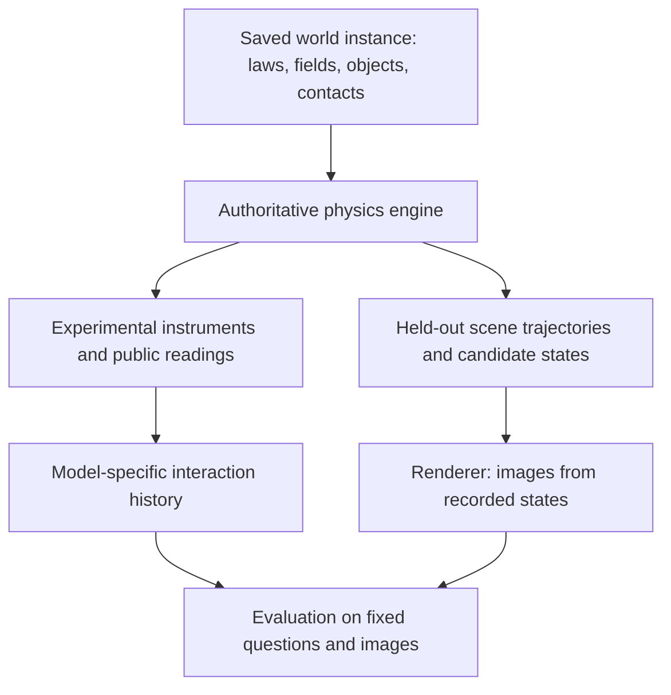

# Worlds, experiments, and visual prediction

Design established on 2026-09-30. The [shared record contracts](world_records.md)
and legacy drag adapter are now implemented. The [constant-strength attraction
runtime](attraction_world.md) and two matched p=2/p=3 worlds are also implemented.
The [common bench](attraction_bench.md) now executes six agent-selected tools for
those worlds. Broader runtime composition and additional interfaces remain planned.
The [host learnability audit](attraction_audit.md) now tests the matched pair
against alternative exponents and continuous strength intervals using budgeted
quantized measurements; its reference policies are never supplied to agents.
The [paired attraction scene suite](attraction_prediction.md) prepares 16 image
questions and checks physical candidates and shortcuts; pixel rendering is a
separate user-launched job.
The existing drag pipeline remains the working reference and its saved records
retain their formats.

## Research question

Can a model discover the rules of an unfamiliar world through experiments and
use the resulting evidence to predict new situations in that same world?

A world is defined by its dynamics, coefficients/fields, objects, and contact
rules. A scene adds initial conditions and a camera. A benchmark instance adds
experimental instruments, information disclosure, budgets, and held-out tasks.
Changing a camera does not create a different physical world. Changing a force
law does. Different models should receive the same saved world and evaluation
scenes but produce their own interaction histories.

## Three independent transformation axes

| Axis | What changes | Examples | What the agent might infer |
|---|---|---|---|
| Law | Functional relationship between physical quantities | Attraction proportional to 1/r^2 or 1/r^3; linear or nonlinear resistance | Law family, exponent, coupling structure |
| Object | Properties of individual objects or object pairs | Mass, density, gravitational coupling, charge; contact restitution for a material/surface pair | Which visible object has which properties |
| Field | Coefficients that are constant or depend on position/time | G, b(z), b(x,y,z,t), spatial stiffness, periodic drag | Constant values, spatial profiles, time dependence |

Treat constant coefficient changes as the simplest field case. Combine axes
only after evaluating them separately: law-only, object-only, field-only, then
pairwise combinations and all three. This makes failures interpretable.

Disclosure is a separate experimental condition. Each law/property/field can be
fully specified, have a known family with hidden parameters, or be hidden within
a declared bounded search space. The private simulator always has the complete
definition. A hidden function is fixed by the world record, not resampled when
the model asks a question.

For example, the existing complex drag task has a disclosed law F=-b(z)v,
calibrated objects and contacts, and a hidden stationary smooth height field.
It exercises field discovery, not discovery of the drag law itself. Its existing
scores provide one tested instance, not evidence that every sampled world is
equally difficult or identifiable.

## Example: modified attraction

The proposed inverse-cube example changes the attraction law; acceleration can
still obey F=m_inertial*a. Altering that latter relation would be another law
transformation and should have its own version.

Use an explicit vector law. One convenient normalized representation is:

```text
r_ij = ||x_j - x_i||
direction_ij = (x_j - x_i) / r_ij

F_(i <- j) = A(x_pair, t)
             * (m_grav_i / m_ref) * (m_grav_j / m_ref)
             * (r_ref / r_ij)^p * direction_ij

a_i = sum_j F_(i <- j) / m_inertial_i
```

Here A has units of newtons; r_ref and m_ref are declared reference scales.
At p=2 and A=G*m_ref^2/r_ref^2 this reproduces the inverse-square force. At p=3
it is an inverse-cube force. If storing the unnormalized expression
G_p*m1*m2/r^p instead, record G_p's units: m^(p+1)/(kg*s^2). Reusing an ordinary
gravitational constant's units after changing the exponent would be inconsistent.

Initially keep gravitational and inertial mass equal. If later varied
independently, record both and provide experiments that can distinguish them.
Specify where a spatial pair coefficient is sampled, e.g. the pair midpoint.
Using the same midpoint coefficient for reciprocal forces preserves their
equal-and-opposite construction. Do not assume a conserved energy for arbitrary
spatial/time-dependent laws; test only invariants implied by the chosen law.

Define the valid separation range and contact behavior. Restrict experiments
and scenes away from the singularity, or explicitly define a softened law as a
different version. The numerical solver must never silently change the force.

## Shared execution contract



The same physics implementation must drive instruments, trajectories, numerical
grading, and candidate generation. Blender receives recorded poses and visual
attributes; its default physics must not substitute for the authored laws.
Every candidate records its alternative physical hypothesis. The correct frame
uses the exact saved world. Candidate hypotheses and keys stay host-only.

Retain specialized analytical and RK4 implementations behind a common interface;
do not replace a validated solver just to standardize its class name. A proposed
interface is `advance(state, start_time_s, duration_s, world, objects, contacts)`.
Force/field evaluation and instrumentation should be separate from integration.

## World records and visibility

Separate reusable definitions from a sampled world instance and a model run:

| Record | Contents | Visibility |
|---|---|---|
| World definition | Registered law implementations, units, reference frames, field definitions and values, supported domain | Private |
| Object registry | Stable identities, appearance, physical properties, geometry | Private master; explicit public projection |
| Contact registry | Object/surface or material-pair response rules | Private master; selected calibrations may be public |
| Protocol | Allowed interventions, instrument resolution, budget, reset/clock rules, disclosed assumptions | Public projection plus private grading settings |
| Scene | Initial state, world start time, requested elapsed time, rendering configuration | Public initial information; private trajectories and answer key |
| Run | Model, prompts, tool calls, measurements, submissions, completion state, numerical scores | Public history separated from private scores |

Keep existing world/object/contact fingerprints and add explicit law, field,
solver, schema, and protocol versions where needed. Record seeds for provenance
and serialize actual sampled parameters so replay does not depend on a future
random generator. Validate all relevant fingerprints before evaluation.
An episode/benchmark identifier should bind the physical records, protocol,
clock convention, and scene suite. Solver version and tolerances must also be
recorded and checked, even if stored separately from the physical world ID.

Public messages must be constructed from an allowlist. Never pass the private
world and try to remove a few known sensitive keys. Do not expose private IDs,
seeds, candidate hypotheses, or answer keys through captions or filenames.

Color is a visible identity cue. Keep identity-to-color mapping fixed throughout
an episode, use clearly distinguishable rendered colors, and vary color/property
assignments across sampled instances to avoid a universal “blue is heavy” rule.
Explicitly choose which properties are hidden. Rendered size and shape can also
reveal information; visibility auditing must include geometry, not only text.
Keep derived quantities consistent, e.g. density=mass/volume unless an explicitly
different material model defines otherwise.

## Agent-selected experimental interfaces

User requirement: provide multiple experimental interfaces and let the agent
plan which ones to invoke. Do not tell it which instrument is useful for the
hidden world, supply an experiment sequence, or select tools based on the hidden
answer. These are experimental tools; private evaluation/scoring is a separate
host interface and is never exposed as a tool for learning the world.

Within a comparison suite, use the same tool names, descriptions, schemas,
ordering, calibration information, and cost rules across law/field variants.
The apparatus must actually support these operations in every instance. A tool
catalog containing only drag experiments would itself disclose a useful prior.
Different apparatus suites may have different catalogs, but their tool access
must be reported as a protocol difference rather than concealed as the same task.

Proposed common bench interfaces (design only):

| Interface | Agent controls | Returned information |
|---|---|---|
| `inspect` | Visible object or apparatus identifier | Appearance, available controls, public calibration and ranges |
| `configure_trial` | Object placements, clamps, allowed initial velocities, start time | Accepted setup and public clock state |
| `apply_impulse` | Actuated object, calibrated impulse vector | Applied input and timing, not inferred object properties |
| `measure_force` | Instrument mount, axis, measurement time | Quantized sensor reading in declared units |
| `track_motion` | Observed objects, duration, allowed sample times | Bounded, quantized position observations |
| `measure_event` | Available gate/contact sensor and time window | Measured event time or no event within that window |
| `wait` / `reset_trial` | Permitted duration or reset operation | Public time/setup changes according to the clock protocol |
| `submit_prediction` / `finish` | Agent's prediction or decision to stop | Receipt only; no correctness feedback |

Names and schemas describe operations, not their intended scientific use.
Document how to attach a force sensor, its reference frame, and what it measures;
do not add “use this tool to identify inverse-cube gravity.” Inspection must not
return hidden masses, law labels, field values, or recommended next actions.
Force probes report the observable load on the specified instrument, not an
internal decomposition into named hidden forces. Motion sampling and sensor
readings must have explicit resolution, range, saturation, and resource costs.

The agent is responsible for selecting instruments, choosing controlled
variables, interpreting observations, deciding what to repeat, and deciding when
to stop. The implementation does not route a hypothesized phenomenon to a
preferred experiment or supply a reference planner's suggestions. An irrelevant
but physically valid experiment returns its actual measurement, including a
zero reading or no detected event; errors describe invalid operations without
revealing a hidden law or recommending a different tool.

Publish costs before interaction. Charge for sampled observations, simulated
duration, or instrument use as appropriate, so a single trajectory request
cannot obtain unlimited information under a one-call budget. Log actual inputs,
measurements, timestamps, costs, and failures. Do not request hidden reasoning
traces; the observable action sequence suffices to analyze experimental choices.

For a law-discovery track, the initial prompt can state:

> You are in an unfamiliar physical environment. Use the available apparatus
> within the stated budget to gather evidence for later prediction tasks.
> Physical behavior may differ from familiar laws. Tool documentation specifies
> controls, calibration, measurement limits, and costs. Choose your own experiments.

It must not identify the active law family, changing coefficient, or useful tool.
If a separate track discloses a law or function family, label that condition
explicitly; it still must not prescribe a tool or plan. The existing drag prompt
is a disclosed-law baseline and should not be silently relabeled as unguided
law discovery. Announce the general prediction task class without revealing
held-out scenes or answer keys.

Acceptance checks: compare serialized tool catalogs and initial public prompts
across matched hidden worlds; audit success/error responses for routing hints;
verify that agents can invoke every advertised operation; and verify cost and
clock accounting. Use the host reference planner only for feasibility audits,
never to choose the evaluated agent's next action. Report performance versus
measurement budget and, as separately labeled controls, performance with fixed
or random experimental policies.

## Space and time

Field records specify input coordinates, units, domain, interpolation, bounds,
and extrapolation. Start with constants, existing smooth height profiles, and
bounded low-dimensional temporal functions. Broader fields can follow once
their experimental interfaces and solvers are validated.

For time-dependent fields, `field(position, absolute_time)` must return the same
value in interaction and rendering. Record a public scene start timestamp and
elapsed time, and evaluate at their sum. A hidden phase is part of the private
world and can be an inference target; it must not change between stages.

Choose and disclose one clock protocol per suite:

- Resettable trials: each intervention specifies an allowed world start time;
  independent trials can revisit a time without altering the field definition.
- Continuous time: interventions, waiting, and resets advance a recorded clock
  according to specified costs. Resetting an object does not implicitly rewind
  the world's field.

The first temporal suite should use resettable trials with controlled start times
so models can vary time and position independently. This is a proposed protocol,
not a capability currently supported by the drag tools. Include a declared time
range and held-out timestamps. A snapshot must communicate enough initial state
and timing to make a unique prediction possible.

## Identifiability and evaluation

More hidden quantities do not automatically make a better benchmark. For example,
if only the product of a coupling and unknown source mass is measurable, asking
for both separately is underdetermined. Supply a calibrated reference object or
an independent instrument, or score only the identifiable predictive quantity.

Before admitting a world/scene, use host-side reference fitting or alternative
hypothesis search with the same accessible measurements and budget. If two
plausible worlds fit the rounded evidence but imply different answers, flag that
case. Exclude it from the ordinary unique-answer suite, or place it in a separately
specified uncertainty task. Failure to find a competing fit is a diagnostic,
not a mathematical proof of identifiability. Report the audit's search limits.

Use separate measurements of capability:

1. Numerical transfer: predict held-out measurements or trajectories, with
   declared tolerances. Exact equation/parameter recovery is optional and should
   not penalize equivalent predictive representations.
2. Visual transfer: answer fixed image questions after experiments. Keep the
   close-candidate strategy where appropriate, but choose meaningful per-task
   distance bounds and screen-space readability checks; 2–8 cm is drag-specific.
3. Learning benefit: compare the same suite with and without interaction history.
   Use law-specific simple baselines and nearest-candidate diagnostics. These
   host-side diagnostics do not replace model evaluations.
4. Information use: report measurement/turn budgets, timeout skips, completion,
   and performance across multiple independent world instances.

Freeze scene generation before comparing evaluated models. Do not choose
distractors in response to one evaluated model's answers. Balance answer labels
and audit geometric shortcuts. Consider paired worlds with similar initial
appearance and different outcomes, so the relevant history determines the
prediction. Such pairs need distinct histories and explicit world bindings.

Maintain separate development and held-out world instances. Later evaluations
can separate parameter interpolation, new field realizations, new object
combinations, and new law families. Report those splits separately rather than
calling every new random seed a new law.

## Repository organization and migration

Build on the existing structure. The following additions are proposed paths:

```text
src/worlds/
  definition.py          # validated world composition and serialization
  laws/                  # named, versioned force/dynamics implementations
  fields/                # constants and spatial/temporal coefficient functions
  ...existing solvers... # retained and adapted
src/objects/             # extend the shared typed property/appearance registry
src/envs/                # experiment apparatus and allowed interventions
src/tasks/               # public prompts, submissions, numerical grading
src/simulation/          # scene preparation, recorded states, Blender rendering
src/evaluation/          # history/image assembly and shared input validation

configs/worlds/<family>/ # authoring templates, not model-visible data
world_instances/<id>/    # immutable instantiated physics and registries
renders/<family>/<instance>/<suite>/
results/interactions/<instance>/<model>/<run>/
results/evaluations/<instance>/<suite>/<model>/<run>/
```

Keep existing paths and historical formats working. Do not move current results
or rename `lab_5` as a prerequisite. New paths can be adopted by new suites;
links and metadata can catalog older records. Use registered implementations
and validated parameters, not arbitrary evaluated equation strings. Equations
in metadata explain the executable implementation and are versioned with it.

Implementation sequence:

1. Adapt the existing drag world to the common record/interface while preserving
   its trajectories, private/public separation, and saved evaluation behavior.
2. Add a constant-coefficient central-attraction family with selectable p=2 or
   p=3 and calibrated reference masses. First separate exponent inference from
   strength inference using measurements at several controlled distances.
3. Add colored objects with hidden properties and adequate calibration tools.
4. Add spatial coefficient fields, then time-dependent fields and explicit clocks.
5. Compose axes into mixed suites, with world-generation audits and fixed test
   images across models.

For the first new scene, use a clearly marked central attractor and a colored
probe moving in a plane. Interactions can measure attraction at selected
separations; evaluation can ask for the probe's position after a specified launch
and duration. State whether the source is fixed, calibrate probe mass, and keep
separation, launch velocity, and elapsed time readable. A fixed-source force
measurement identifies the law exponent from distance dependence; independent
calibration separates force strength from hidden mass in later variants.

Acceptance checks for each new family: record round trips; solver convergence
and analytical limits where available; experiment/scene consistency; explicit
clock behavior; visibility and leakage checks; distinguishable candidate images;
appropriate simple baselines; and reproducible evaluation across models.
